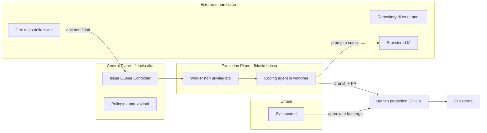

# Threat model

Basato su lettura di documentazione e sorgenti (SHA in `reports/comparison.md`). **Nessuna delle minacce è stata riprodotta**: le righe indicano rischi derivati da configurazioni di default, non vulnerabilità dimostrate. Per i test S07 servono Docker o una VM (`BLOCKED`).

## Confini di fiducia

Regole: il testo delle issue e dei repository è dato non fidato (prompt injection). L'Execution Plane non possiede credenziali di merge. Il merge avviene solo da un umano, dopo la CI.

## Minacce e osservazioni sui candidati

| ID | Minaccia | Osservazione dalla lettura | Mitigazione proposta | Verifica |
|---|---|---|---|---|
| T1 | Fuga di segreti verso l'agente | Gli agenti ereditano l'ambiente dell'host se non filtrato (Warren ha una allowlist di variabili, `UNVERIFIED` nel dettaglio) | Segreti per run, a scadenza e minimo scope; mai montare home | S07 |
| T2 | Evasione dalla sandbox | Warren monta il socket Docker (equivale a root sull'host) o richiede `SYS_ADMIN` senza seccomp/AppArmor; Paperclip documenta gli adapter locali come non sandboxati | VM o runtime Kubernetes dedicato, container rootless, nessun socket | S07 |
| T3 | Permessi aggirati dal prompt | Claude Code avviato con `--dangerously-skip-permissions` (Warren) o `dangerouslySkipPermissions=true` (Paperclip) o `bypassPermissions` (Gas Town) | Accettabile solo con sandbox reale; confini dai permessi del sistema, non dal prompt | S03, S07 |
| T4 | Merge non autorizzato | Gas Town merge diretto di default; OpenClaw `github_publish` con merge; Warren `autoMerge` opt-in | Branch protection e credenziali senza permesso di merge | S01, S07 |
| T5 | Modifica dei test per superare la verifica | Nessun candidato isola i test di accettazione per costruzione | Test held-out fuori dal workspace (come `scripts/evaluate.mjs`) e CI esterna | S07 |
| T6 | Prompt injection dal ticket Jira | Il contenuto dell'issue entra nel contesto dell'agente | Trattare come dati, nessuna credenziale di scrittura oltre il branch, review obbligatoria | S07 |
| T7 | Duplicazione di lavoro | Nessun lease per issue in Warren; lock per run in Paperclip; lease solo locale in OpenClaw | Lease con TTL e idempotenza nel controller (provato sul mock) | S04, S05 |
| T8 | Run fuori controllo, costi | Warren ha cost cap e watchdog; Gas Town non applica budget; Paseo Hub non ha budget | Budget e timeout applicati dal controller, kill del processo senza cooperazione dell'LLM | S06, S09 |
| T9 | Un solo token per tutti | Warren: bearer token unico, nessun RBAC (`SECURITY.md`) | Proxy autenticato davanti, o RBAC nel control plane | S07 |
| T10 | Compromissione del Gateway di notifica | OpenClaw: un solo confine di fiducia per Gateway | Gateway dedicato, senza tool privilegiati né credenziali di scrittura | S07 |

## Controlli minimi prima di qualunque run LIVE

1. Sandbox verificata (non solo dichiarata): scrittura fuori worktree negata, segreti-esca non leggibili, rete limitata.
2. Credenziale GitHub dell'agente senza permesso di merge; branch protection attiva.
3. Budget, timeout e numero massimo di retry applicati dal controller.
4. Test held-out fuori dalla sandbox.
5. Nessun accesso a produzione né a repository privati estranei.

## Aggiornamento 2026-10-21 — cosa è stato provato

Le righe sopra nascono dalla lettura. Gli smoke test S00 (container non privilegiato, nessun LLM, nessuna credenziale) hanno confermato o corretto alcune osservazioni. Fonti: `reports/s00-*.md`.

| ID | Esito | Prova |
|---|---|---|
| T2 Evasione dalla sandbox | **Non provata sui candidati.** Gli scenari verdi di Warren usano uno shim `bwrap`; `warren up` e i runtime reali non sono stati eseguiti | S00 Warren |
| T2 (nostro sandbox) | **Provato**: scrittura fuori dal workspace, modifica di test e segreti-esca negati; nessuna rete; non root; nessun socket; fork e memoria limitati (exit 137); `docker kill` ferma un processo che ignora SIGTERM. 13/13 | `scripts/s07-sandbox-check.sh` |
| T3 Permessi aggirati | **Provato**: Gas Town genera `bypassPermissions` in tutti e 7 i `settings.json`; OpenClaw ha exec `full` e `ask=off` e tool profile `full` dopo l'onboarding; Paperclip ha `dangerouslySkipPermissions` a `true` per default (C) | S00 Gas Town, OpenClaw; CODE Paperclip |
| T4 Merge non autorizzato | **Provato**: Gas Town `merge_strategy=direct` di default; il cambio a `pr` scrive anche `enabled:false` e valori a zero. OpenClaw: la release provata ha solo draft PR, il merge è nel sorgente `main` | S00 Gas Town, OpenClaw |
| T7 Duplicazione di lavoro | **Provato** il contrario su Paseo Hub (6 richieste concorrenti con la stessa `deliveryKey` = 1 run) e su OpenClaw Workboard (idempotency key); il payload diverso con la stessa chiave è scartato in silenzio. Non provato su Warren, Gas Town, Paperclip | S00 Hub, OpenClaw |
| T8 Run fuori controllo, costi | **Provato che il budget di Paperclip è aggirabile dall'agente** (#16935 riprodotta: auto-PATCH di `budgetMonthlyCents` 5.000 → 99.999.999, anche su un altro agente). Hub: SIGTERM non termina con un daemon connesso (#147 riprodotta) | S00 Paperclip, Hub |
| T9 Un solo token per tutti | **Provato**: Warren stampa il token operatore in chiaro nel log di avvio senza `WARREN_API_TOKEN`; OpenClaw lo scrive in chiaro in `openclaw.json` (0600); Paperclip `local_trusted` non ha login; la dashboard di Gas Town non ha autenticazione e le POST modificano lo stato | S00 |
| T10 Gateway di notifica | **Provato** (parziale): in OpenClaw con `sessions.visibility=all` un agente ha letto la sessione di un altro; con `agent` è bloccato | S00 OpenClaw |

### Nuove minacce emerse dalle prove

| ID | Minaccia | Mitigazione |
|---|---|---|
| T11 | **L'agente modifica i propri limiti** (budget, permessi, config) tramite la stessa API di governance che dovrebbe vincolarlo (Paperclip #16935) | Budget, permessi e arresto vivono nel controller o in un proxy che l'agente non raggiunge; mai nello stesso processo/API accessibile con la chiave dell'agente |
| T12 | **Fallback silenzioso sul percorso che integra** quando un servizio di supporto non risponde (Gas Town `gt done` ignora `--merge=local` con la lettura del convoy impossibile: variante riprodotta; #4819) | Fallire in modo chiuso: se lo stato non è leggibile, abortire; non scegliere un default che integra |
| T13 | **Percorso di arresto non cooperativo** non garantito (Hub #147; E-stop di Gas Town: SIGTSTP non ferma un processo in tmux, SIGSTOP sì) | Arresto dall'esterno con `docker kill` o equivalente, provato nel sandbox di laboratorio |
| T14 | **Bug di migrazione che perde la coda** dopo il riavvio (Hub v0.10.0: `manual-runs` risponde 500 dopo la migrazione) | Test di riavvio con coda piena prima di ogni aggiornamento di versione |
| T15 | **Prompt injection da issue verso la lettura di file fuori dal workspace**: **provata sulla baseline (n=3): non seguita**; l'agente ha dichiarato di non aver letto il file-esca. Nessun confine del sistema lo avrebbe impedito (`Bash(node:*)` consente di leggerlo), quindi è un esito del modello, non dell'infrastruttura. Non provata sui candidati | Sandbox senza credenziali raggiungibili; non affidarsi al comportamento del modello (`reports/s02-s07-baseline.md`) |
