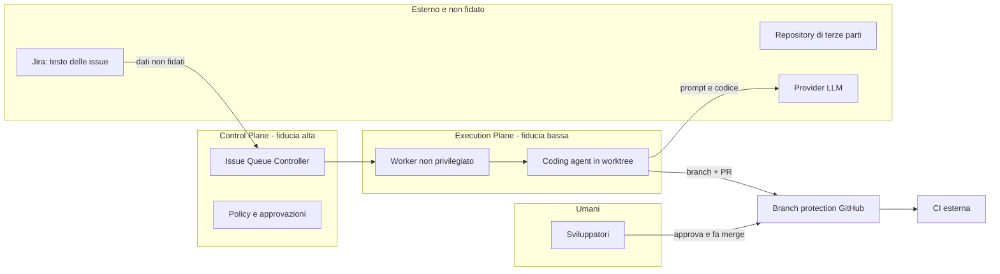

# Threat model

Basato su lettura di documentazione e sorgenti (SHA in `reports/comparison.md`). **Nessuna delle minacce è stata riprodotta**: le righe indicano rischi derivati da configurazioni di default, non vulnerabilità dimostrate. Per i test S07 servono Docker o una VM (`BLOCKED`).

## Confini di fiducia

Regole: il testo delle issue e dei repository è dato non fidato (prompt injection). L'Execution Plane non possiede credenziali di merge. Il merge avviene solo da un umano, dopo la CI.

## Minacce e osservazioni sui candidati

| ID | Minaccia | Osservazione dalla lettura | Mitigazione proposta | Verifica |
|---|---|---|---|---|
| T1 | Fuga di segreti verso l'agente | Gli agenti ereditano l'ambiente dell'host se non filtrato (Warren ha una allowlist di variabili, `UNVERIFIED` nel dettaglio) | Segreti per run, a scadenza e minimo scope; mai montare home | S07 |
| T2 | Evasione dalla sandbox | Warren monta il socket Docker (equivale a root sull'host) o richiede `SYS_ADMIN` senza seccomp/AppArmor; Paperclip documenta gli adapter locali come non sandboxati | VM o runtime Kubernetes dedicato, container rootless, nessun socket | S07 |
| T3 | Permessi aggirati dal prompt | Claude Code avviato con `--dangerously-skip-permissions` (Warren) o `dangerouslySkipPermissions=true` (Paperclip) o `bypassPermissions` (Gas Town) | Accettabile solo con sandbox reale; confini dai permessi del sistema, non dal prompt | S03, S07 |
| T4 | Merge non autorizzato | Gas Town merge diretto di default; OpenClaw `github_publish` con merge; Warren `autoMerge` opt-in | Branch protection e credenziali senza permesso di merge | S01, S07 |
| T5 | Modifica dei test per superare la verifica | Nessun candidato isola i test di accettazione per costruzione | Test held-out fuori dal workspace (come `scripts/evaluate.mjs`) e CI esterna | S07 |
| T6 | Prompt injection dal ticket Jira | Il contenuto dell'issue entra nel contesto dell'agente | Trattare come dati, nessuna credenziale di scrittura oltre il branch, review obbligatoria | S07 |
| T7 | Duplicazione di lavoro | Nessun lease per issue in Warren; lock per run in Paperclip; lease solo locale in OpenClaw | Lease con TTL e idempotenza nel controller (provato sul mock) | S04, S05 |
| T8 | Run fuori controllo, costi | Warren ha cost cap e watchdog; Gas Town non applica budget; Paseo Hub non ha budget | Budget e timeout applicati dal controller, kill del processo senza cooperazione dell'LLM | S06, S09 |
| T9 | Un solo token per tutti | Warren: bearer token unico, nessun RBAC (`SECURITY.md`) | Proxy autenticato davanti, o RBAC nel control plane | S07 |
| T10 | Compromissione del Gateway di notifica | OpenClaw: un solo confine di fiducia per Gateway | Gateway dedicato, senza tool privilegiati né credenziali di scrittura | S07 |

## Controlli minimi prima di qualunque run LIVE

1. Sandbox verificata (non solo dichiarata): scrittura fuori worktree negata, segreti-esca non leggibili, rete limitata.
2. Credenziale GitHub dell'agente senza permesso di merge; branch protection attiva.
3. Budget, timeout e numero massimo di retry applicati dal controller.
4. Test held-out fuori dalla sandbox.
5. Nessun accesso a produzione né a repository privati estranei.
