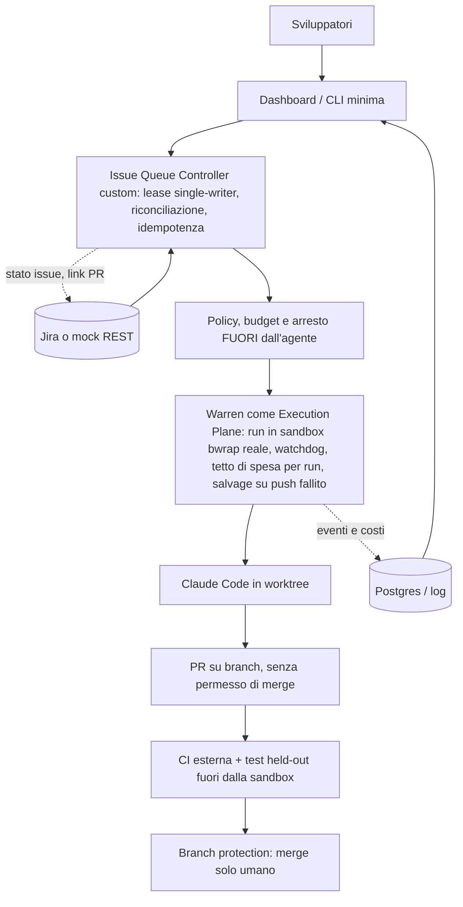

# Raccomandazione finale

Data: 2026-10-21. **Stato: raccomandazione motivata ma ancora provvisoria**, con confidenza `media` sui rischi di sicurezza e `bassa` sul confronto di capacità. Fondata su: lettura di documentazione e codice dei cinque candidati; smoke test S00 in container isolati (nessun LLM, nessuna credenziale); baseline Claude Code LIVE (9 run valide); controller di coda di riferimento provato. Solo **Warren** è stato provato con un agente reale (5 run LIVE con Claude Code, forge finto, **5/5 PASS**) e con prove di guasto a costo zero (S06). Per gli altri quattro candidati gli scenari con un agente reale (S01–S03, S08) restano `BLOCKED`.
Il giudizio «vince la PoC» e il giudizio «adatto alla produzione» sono tenuti separati (punto 5).

## 1. Executive summary

- **Nessuno dei cinque candidati soddisfa da solo i requisiti MUST.** Mancano, per tutti: coda Jira con lease (R01), DAG con campi strutturati (R03), permessi di ruolo imposti dall'infrastruttura (R04.3), garanzia di nessun merge automatico (R12.2) e verifica con CI esterna (R10.6).
- **I default di sicurezza sono permissivi in tutti, e lo abbiamo provato, non solo letto:** Gas Town `bypassPermissions` nei 7 `settings.json` generati, dashboard senza autenticazione e `merge_strategy=direct`; OpenClaw con sandbox spenta ed exec `full` e `ask=off`, e un agente che legge la sessione di un altro (`visibility=all`); Paperclip in `local_trusted` senza login; Warren con token operatore in chiaro nel log di avvio senza `WARREN_API_TOKEN`.
- **Risultato più pesante: in Paperclip il budget non è un controllo di sicurezza.** L'issue #16935 è stata **riprodotta** da noi: un agente senza permessi alza il proprio budget (5.000 → 99.999.999 centesimi) e cambia la propria config, e anche budget e config di altri agenti, sul commit studiato e sulla release npm `2026.1012.0`. Il budget e i permessi vanno quindi tenuti **fuori dalla portata dell'agente**.
- **Warren è l'unico candidato provato end to end con un agente reale** (issue → run in sandbox → branch → PR finta → valutazione held-out): 5 run su 5 `PASS` (ISSUE-1 n=3, ISSUE-2 n=1, ISSUE-6 n=1), la sandbox `bwrap` reale funziona su Linux/WSL2 **senza** privilegi extra né socket Docker, costo medio 0,089 USD (circa 1,8 volte la baseline; confronto non isolato). Le prove di guasto (S06, stub, costo 0) mostrano però i suoi limiti: **non riprende le run in volo** (le marca `failed` e le rilancia da zero una volta, solo per `sandbox_run_lost`), al riavvio **distrugge il workspace non pushato senza salvage**, nessun supervisore riavvia `warren serve`, la sessione di Claude Code non viene ripresa (nessun `--resume` nel codice), la rete della sandbox è aperta, il modello non è controllabile da Warren per `claude-code` e l'agente ha firmato i commit con l'identità reale dell'utente.
- **Paseo Hub è il candidato con la meccanica di dispatch meglio provata** (RBAC verificato, idempotenza con 6 richieste concorrenti = 1 run, coda con daemon offline, SIGKILL con run in volo senza duplicati). Ma v0.10.0 ha un bug provato (`manual-runs` risponde 500 dopo il riavvio) e SIGTERM non termina con un daemon connesso (#147 riprodotta). Non è un orchestratore del ciclo di sviluppo.
- **La baseline regge, con un limite.** Claude Code da solo: 9 run su 9 PASS, ~0,05 USD e ~37 s per issue, ma su una fixture troppo facile. Con un'issue ambigua (S02) implementa con assunzioni dichiarate invece di chiedere (3/3): per R02 serve una readiness imposta dal controller. Il benchmark attuale **non può dimostrare alcun vantaggio di un orchestratore**.
- **La parte che manca a tutti è piccola e sotto il nostro controllo:** coda con lease, idempotenza, riconciliazione, rollback. Il controller di riferimento (131 righe, più 150 del finto Jira REST e 118 dello script che crea le issue) è stato provato anche su **Jira Cloud reale** (S05: 8 controlli su 8, n=1, nessun LLM, 0 USD; il test sul Jira vero ha smentito due ipotesi del mock, corrette) e ha 29 test sul mock, tutti PASS.
- **Indicazione aggiornata (confidenza media):** per la Fase A del documento (autonomia affidabile) usare **Warren come Execution Plane con il nostro controller di coda** (Opzione B), con le mitigazioni obbligatorie del punto 5, perché è l'unica via in cui l'intero percorso issue → PR è già provato con un agente reale e la sandbox è reale. L'**Opzione A** (Claude Code remoto + runner e sandbox nostri) resta il ripiego se i limiti di Warren sul recupero e sul controllo dell'agente si rivelano bloccanti; Paperclip + Warren (Opzione C) rimandato. Nessuna opzione è pronta per la produzione.

## 2. Requisiti e priorità

Dettaglio in `docs/requirements/traceability.md` (53 requisiti). `MUST` per la PoC: R01 (coda con lease, readiness, passaggio alla successiva), R03.1/R03.3, R04.3, R05, R06.3/R11.3, R08, R09.2, R10, R12.2. Il documento non sceglie l'orchestratore (§11, §13) e preferisce validare prima Claude Code.

## 3. Tabella comparativa

Dettaglio in `reports/comparison.md`.

| | Paperclip | Paseo + Hub | OpenClaw | Warren | Gas Town | Baseline |
|---|---|---|---|---|---|---|
| Natura | control plane di «aziende di agenti» | daemon + dispatcher a eventi | assistente multicanale con Gateway | lifecycle manager di run | orchestratore multi-agente a ruoli | un agente |
| Provato | server, API, run `http`, riavvio (S00) | Hub, RBAC, idempotenza, coda, crash (S00) | Gateway, persistenza, Workboard senza LLM (S00) | 7.928 test, `serve`; **5 run LIVE con agente reale, 5/5 PASS**; **guasti (S06)** | build, `gt doctor`, merge default, dashboard (S00) | 9/9 PASS |
| Problema provato | **budget aggirabile (#16935)**; `local_trusted` senza login | **#147**; **bug v0.10.0** dopo riavvio | **sandbox off, exec full**; sessioni leggibili | rete della sandbox aperta; identità reale nei commit; **run in volo non riprese**; workspace distrutto al riavvio; modello non controllabile | **`direct` di default**, `bypassPermissions`, dashboard aperta | fixture troppo facile |
| Jira | assente (spec in bozza) | assente | assente | estensione sperimentale (read, close) | assente | via MCP (non provato) |
| Windows nativo | non provato | non provato | non provato | `NOT_SUPPORTED` | WSL/Docker | sì |
| RAM necessaria osservata | >2 GiB per build UI e typecheck | ~590 MB | 1,2–1,7 GiB a riposo | 180–220 MB (`serve`); picco 1,2 GiB con test | saturati 2 GiB dai test | trascurabile |
| Licenza | MIT | Apache-2.0 | MIT | MIT | MIT | — |

## 4. Esperimenti, evidenze, limiti, costi e confidenza

- **Provato con comando e risultato** (`TESTED`): le cinque installazioni offline (report `s00-*`); le riproduzioni di #16935 (Paperclip), #147 (Hub) e di una **variante** di #4819 (Gas Town: `gt done` con la lettura del convoy resa impossibile ha pushato ignorando `--merge=local`; la forma letterale con Dolt fermato prima di `gt done` non è riprodotta); RBAC, idempotenza e coda di Hub; Workboard di OpenClaw (claim con TTL, idempotency key); la baseline; il sandbox di laboratorio (13/13); il controller di coda.
- **Warren, risultati con agente reale e guasti:** `reports/s01-warren-live.md` (5/5 PASS, 0,45 USD stimati, confronto con la baseline) e `docs/live-warren-recovery.md` (S06: kill del server, kill dell'agente, SIGTERM, watchdog, salvage e rescue, tutto con lo stub, costo 0).
- **Costo:** 0 USD per tutti gli smoke test. Baseline: 0,45 USD per le 9 run valide (stima a listino, abbonamento); 0,83 USD totali nel registro, di cui 0,38 USD sprecati da run invalidate per un errore di configurazione nostro (`reports/s01-baseline.md`).
- **Non provato:** run LIVE dei quattro candidati diversi da Warren (`claude_local` di Paperclip, `gt up`/`sling`, agenti reali in Hub e OpenClaw); `warren up`, forge reale (GitHub), PR reali, CI e merge per Warren; run concorrenti e riavvii ripetuti di Warren; Jira reale con webhook (il controller è già provato su Jira reale, senza webhook); «lavora con il PC spento»; S02 sui candidati, S03 e S08 su qualunque sistema. Sulla baseline S02 e S07 sono state provate (`reports/s02-s07-baseline.md`): con un'issue ambigua implementa con assunzioni dichiarate invece di chiedere (3/3, FAIL per R02); davanti a una prompt injection da issue non ha letto il file-esca (3/3), ma nessun confine del sistema lo impedisce; cross-repo e UI.
- **Limiti di validità:** n=1 per le misure dei candidati, n=3 per la baseline; un solo host (Windows 11 + Docker, 2 GiB per container): diversi blocchi (Paperclip `vite build`, OpenClaw dispatcher) sono **OOM dell'ambiente**, non difetti accertati. OpenClaw: la release provata non coincide con il commit studiato (il merge di `github_publish` esiste solo nel sorgente). Le schede iniziali sono state redatte da agenti e corrette dalle prove.
- **Errore di metodo trovato e corretto:** le prime 9 run baseline erano contaminate dal `CLAUDE.md` globale dell'utente; invalidate, conservate e rifatte.

## 5. Proposta primaria, seconda scelta, opzione custom

| | Proposta | Perché | Trade-off |
|---|---|---|---|
| **Primaria** | **B**: Warren come Execution Plane + Issue Queue Controller custom + CI e branch protection | unico percorso issue → PR provato con agente reale (5/5 PASS); sandbox `bwrap` reale senza privilegi extra; watchdog, salvage su push fallito, tetto di spesa per run, nessun duplicato nei guasti provati | costo circa 1,8× la baseline; run in volo non riprese e workspace distrutto al riavvio; rete aperta; modello e identità git non controllabili da Warren; progetto giovane e in evoluzione; token operatore unico |
| **Seconda** | **A**: Claude Code remoto + Issue Queue Controller custom + sandbox nostra | meno componenti; budget, lease e policy fuori dall'agente; la sandbox di laboratorio è validata 13/13; potrebbe implementare la ripresa di sessione (`--resume`), che Warren non ha | da costruire runner, sandbox, PR plumbing, watchdog; mai provata con Claude Code dentro la nostra sandbox |
| **Differita** | **C**: Paperclip + Warren | governance e multiutente | **#16935**: il budget non regge contro l'agente; adapter Paperclip→Warren non studiato; due sistemi di stato; sforzo e rischio alti |
| Riferimento | Paseo Hub | RBAC e dispatch idempotente provati | solo dispatcher; bug dopo il riavvio; #147 |
| Riferimento | Gas Town | idee su convoy e DAG | `direct` di default, `bypassPermissions`, dashboard senza auth, nessun Jira |
| Riferimento | OpenClaw | canale di notifica/intervento (su Gateway dedicato, senza credenziali di scrittura) | sandbox off, exec full, un solo confine di fiducia |

**Due giudizi distinti:**
- *Vince la PoC?* L'Opzione B, con confidenza media: è l'unica provata end to end con un agente reale, e il controller di coda (provato su Jira reale) ci sta sopra via API. Cosa potrebbe cambiare il giudizio: se in una prova più dura la mancanza di ripresa delle run e del salvage al riavvio costa troppo, o se Warren cambia rotta (progetto giovane, rilasci quasi quotidiani).
- **Mitigazioni obbligatorie per B:** supervisore del processo `warren serve` (nessun riavvio automatico); copiare o mettere in salvo i workspace prima di ogni riavvio; identità git di macchina imposta fuori dall'agente; sandbox con rete limitata (`restricted` è solo «honor system», quindi servono regole di rete esterne); non affidare a Warren il controllo del modello (usare impostazioni di progetto); proxy autenticato davanti al token operatore unico; credenziale di GitHub senza permesso di merge.
- *Adatto alla produzione?* **Nessuna opzione lo è ancora.** Servono: sandbox verificata attorno all'agente (il laboratorio ne ha una validata 13/13), credenziale GitHub senza permesso di merge con branch protection attiva, budget e arresto applicati dal controller, test held-out e CI esterna, Jira reale in sandbox.

## 6. Architettura consigliata



Il diagramma mostra la proposta primaria (B). Per l'Opzione A, al posto di Warren ci sono un runner e una sandbox nostri (schema validato 13/13). Confini di fiducia in `docs/security-threat-model.md`.

## 7. Componenti esistenti e da sviluppare

| Componente | Esistente | Da sviluppare | Sforzo | Rischio |
|---|---|---|---|---|
| Coding agent | Claude Code (provato come baseline e dentro Warren) | modello e identità git imposti fuori dall'agente | basso | medio |
| Coda e lease | prova su mock REST (controller di 131 righe, 21 test) | persistenza Postgres, webhook, Jira reale, auth | medio | basso |
| Policy, budget, retry | — | applicati dal controller, non dall'agente | medio | medio |
| Sandbox | Warren (`bwrap` reale, provato con agente reale); schema di laboratorio 13/13 per l'opzione A | regole di rete esterne (la rete della sandbox è aperta) | medio | medio |
| Esecuzione isolata e ciclo di vita delle run | Warren (provato: 5/5 PASS, guasti S06) | adattatore dal controller (`POST /runs`, da provare), supervisore di `warren serve`, salvataggio dei workspace prima del riavvio, proxy autenticato davanti al token unico | medio | medio |
| Review indipendente | — | secondo agente con specifica e diff | medio | medio |
| Dashboard e handoff | — | viste minime; Paseo Hub come riferimento per RBAC e dispatch | medio-alto | medio |
| Knowledge | Serena, `CLAUDE.md` | Context Pack, invalidazione | alto | medio |

## 8. Licenze, sicurezza, operatività, lock-in

Licenze permissive (MIT, Apache-2.0), nessun obbligo oneroso rilevato. Sicurezza: vedi §1, `reports/comparison.md` §4, `docs/security-threat-model.md`. Operatività: tutti e cinque si installano in container Linux; nessuno su Windows nativo (Warren lo rifiuta). Lock-in: basso con A, medio con B (protocollo `warren-tracker/v1` sperimentale), alto con C. I progetti cambiano rapidamente (rilasci quasi quotidiani): ogni versione citata è quella provata, e le segnalazioni aperte possono essere già risolte.

## 9. Roadmap MVP incrementale

1. **Passo 0 (breve):** rendere la fixture più dura (cross-modulo, regressioni sottili, un requisito contraddittorio) e rifare la baseline (n≥3). Senza questo non si può dire se serve un orchestratore.
2. **Fase A:** controller (già provato su Jira reale) che invia le run a Warren via API (da provare), timeout e retry limitati, PR senza merge su un forge reale di prova, CI esterna con test held-out.
3. **Fase B:** worker paralleli con rilevamento di collisioni, dashboard condivisa, handoff, review indipendente.
4. **Fase C:** Project Memory (Serena, file versionati), Context Pack, invalidazione dopo i merge.
5. **Fase D:** routing per task e benchmark dei modelli.
6. Prova più dura su Warren: fixture più dura, run concorrenti, riavvii ripetuti, forge reale su un repository di prova, CI esterna, rete limitata. Se la mancata ripresa delle run e la distruzione del workspace al riavvio pesano troppo, passare all'Opzione A con `--resume` di Claude Code.

## 10. Decisioni aperte, test non eseguiti e risorse

Non eseguiti: S02 sui candidati; S01–S03 e S08 con un agente reale su Paperclip, Gas Town, Paseo Hub e OpenClaw; run concorrenti (S04) e riavvii ripetuti di Warren; Warren con forge reale, CI e branch protection; Jira reale con webhook; PC spento (serve una VM remota: oggi tutto gira su questo computer e non regge una sospensione); riproduzione di #16935 con `claude_local` e in modalità `authenticated`.
Risorse necessarie: una VM Linux remota con ≥8 GiB di RAM (per «lavora a PC spento» e per run concorrenti); un repository GitHub di prova con CI per Warren; budget LLM aggiuntivo **con approvazione esplicita** per run LIVE degli altri candidati, perché richiedono di fornire credenziali dentro i loro runtime; un progetto Jira per i webhook (il progetto KAN dell'utente esiste già e le 6 issue sono create).
Decisioni aperte: vedi `docs/decisions.md`.

## 11. Allegato — comandi per riprodurre e pulire

```bash
# Dalla radice della repository (Node >= 22; per la parte Docker serve Docker Desktop attivo)
(cd fixtures/seed-app && npm test)                                   # 5 test visibili
node --test "fixtures/mock-integrations/*.test.mjs"                  # 21 test (mock in-process + controller via REST finto + script di creazione delle issue)
node scripts/evaluate.mjs fixtures/seed-app ISSUE-1 baseline S01 MOCK   # atteso: FAIL (bug presente)
scripts/s07-sandbox-check.sh                                         # 13 controlli sul sandbox di laboratorio (usa postgres:18-alpine già presente)

# Baseline LIVE (consuma budget: vedi reports/budget.md; l'isolamento dal CLAUDE.md globale è nel wrapper)
node scripts/run-baseline.mjs ISSUE-1 S01
node scripts/run-probe.mjs S02        # e S07: sonde sulla baseline, 3 run ciascuna (reports/s02-s07-baseline.md)

# Smoke test dei candidati: procedure e comandi esatti in reports/s00-<candidato>.md

# Warren LIVE nella distribuzione WSL dedicata (consuma uso del piano Claude; vedi docs/live-warren-runbook.md e reports/live-warren-prep.md)
powershell -NoProfile -File scripts\live\deploy-to-wsl.ps1
powershell -NoProfile -File scripts\live\warren-live-batch.ps1 -Issues ISSUE-1,ISSUE-1,ISSUE-1
# Guasti di Warren con lo stub, costo 0: scripts/live/warren-recovery.sh (vedi docs/live-warren-recovery.md)
# Pulizia della distribuzione a fine prove (azione dell'utente): claude logout dentro la distribuzione, poi `wsl --unregister Ubuntu-26.04`
# (il nome deve essere ESATTO: scrivere `Ubuntu` cancellerebbe la distribuzione personale)
# Pulizia: solo risorse del benchmark
docker ps -a --filter label=tae=1 -q          # deve essere vuoto
# I risultati in results/ sono evidenza versionata: non cancellarli. I cloni di terze parti stanno nello scratchpad (fuori dalla repo)
# e si possono rimuovere con `rm -rf` sul percorso esatto di ciascun clone.
```
