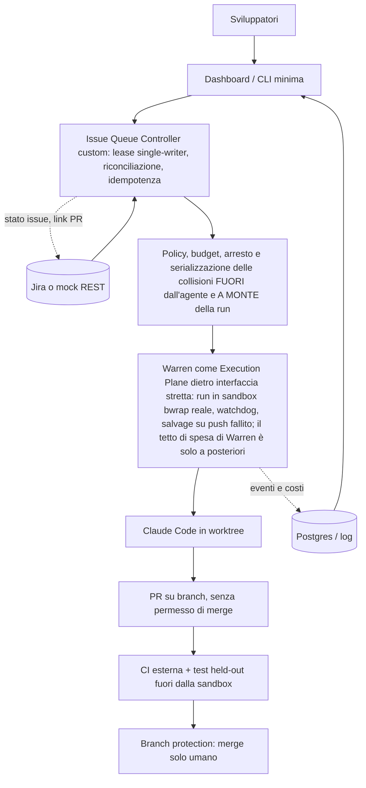

# Raccomandazione finale

Data: 2026-10-22. **Stato: raccomandazione motivata ma ancora provvisoria.** Fondata su: lettura di documentazione e codice dei cinque candidati; smoke test S00 in container (nessun LLM); **run LIVE con un agente reale (Claude Code, `claude-sonnet-5-5`) su ISSUE-1 per tutti e cinque i candidati** (baseline 9 run, Warren 5, Paperclip 2, Paseo 2, OpenClaw 2, Gas Town 2: **tutte con test held-out PASS**, cioè effetto soffitto e nessuna differenza di qualità dimostrata); prove mirate di controllo e sicurezza (Warren: S09 tetto di costo, S07 injection, S04 parallelismo e collisioni; guasti S06 con agente finto; Paperclip #16935 con `claude_local`); baseline su S02, S03 (reviewer indipendente), S07, S08 (handoff); controller di coda provato su Jira reale. Termini usati: **PoC** = *proof of concept*, prova di fattibilità; **Control Plane** = la parte che decide *cosa* far girare, *quando* e *con quali limiti* (coda, lease, budget, arresto, approvazioni); **Execution Plane** = la parte che fa girare l'agente in una sandbox e produce branch e PR; **lease** = prenotazione con scadenza di una issue, perché due worker non la prendano insieme.
**Confidenza (scomposta).** Complessiva `media`, invariata. `Medio-alta` sul fatto che serva un Control Plane nostro (le prove vanno tutte nella stessa direzione per cinque candidati); `bassa-media` sulla scelta fra Warren e un runner nostro come Execution Plane (B contro A): con questi dati non si distinguono. Il giudizio «vince la PoC» e il giudizio «adatto alla produzione» sono tenuti separati (punto 5).

## 1. Executive summary

- **Risposta breve: l'ordine non cambia (B primaria, A seconda, C differita), cambiano i motivi e il perimetro.** Il Control Plane va costruito da noi in ogni caso. Warren resta primo come Execution Plane solo perché è l'unico con sandbox, branch e PR **nativi** provati con un agente vero; **non** perché offra un controllo di spesa o di collisioni affidabile: le prove nuove hanno tolto questi due argomenti (punto 5).
- **Nessuno dei cinque candidati soddisfa da solo i requisiti MUST.** Mancano, per tutti: coda Jira con lease (R01), DAG con campi strutturati (R03), permessi di ruolo imposti dall'infrastruttura (R04.3), garanzia di nessun merge automatico (R12.2), verifica con CI esterna (R10.6) e, emerso ora, **un arresto per spesa che funzioni a metà run** (R06.3): in Warren il tetto scatta a run finita; in Paperclip il budget è aggirabile dall'agente e in abbonamento non si consuma mai.
- **Tutte le run LIVE su ISSUE-1 sono PASS (13 run dei candidati più 9 della baseline): effetto soffitto.** Nessun candidato è scartabile per qualità del codice e nessuno risulta migliore. Le differenze sono nel costo (da 1,6 a 4,9 volte la baseline su ISSUE-1: Paseo 1,6, Warren 2,1, Paperclip 2,5, OpenClaw 4,1, Gas Town 4,9), nei confini di sicurezza e nel comportamento operativo. Confronti non isolati, n=2–9, costi a listino.
- **I default di sicurezza sono permissivi in tutti, provato con agenti veri:** Paperclip: in `local_trusted` senza login e il motore ACP predefinito ha lanciato Claude Code fuori dal wrapper; Paseo: **senza password chiunque raggiunga la porta esegue comandi sull'host** e `PASEO_PASSWORD` finisce nell'ambiente dell'agente; OpenClaw: sandbox spenta, exec `full`, confinabile solo mettendo **l'intero Gateway** in `bwrap`; Gas Town: `--dangerously-skip-permissions`, `merge_strategy=direct` di default, confinabile solo con l'intero Gas Town in `bwrap`; Warren: rete della sandbox aperta, credenziali copiate nel workspace (file non tracciato visibile all'agente).
- **Risultato più pesante: in Paperclip budget e config non sono controlli di sicurezza.** #16935 **riprodotta** (anche con `claude_local`, in `local_trusted` e `authenticated`): con la sola chiave dell'agente si alzano budget (5.000 → 99.999.999 centesimi) e config propri e di altri agenti; si può anche togliere il confinamento (`engine: "acp"`, `agentCommand`, `replaceAdapterConfig`: richieste accettate, esecuzione non provata). In più, con il login in abbonamento la spesa registrata è **0 centesimi**: il budget non scatta mai. Budget e permessi vanno tenuti **fuori dalla portata dell'agente** (D14).
- **Warren: 13 run con agente vero, tutte con held-out PASS; commit, branch e PR (finta) prodotti dal sistema.** Costo medio 0,0945 USD su ISSUE-1 (2,1× la baseline). Limiti provati: **il tetto di costo scatta a run finita** (tetto 0,01 USD, costo 0,101 USD = 10,1×, run marcata `cancelled`, branch pushato); **nessun lock**: due run sullo stesso file danno due PR in conflitto, visibile solo al merge; l'idempotenza esiste solo con una chiave fornita dal chiamante, in memoria per 10 minuti; **non riprende le run in volo** (guasti provati con agente finto); rete aperta; modello non controllabile (si fissa col `settings.json` di progetto); identità git dipende dall'agente. Le injection (ticket e `AGENTS.md`) sono state **ignorate dal modello**: è resistenza del modello, non un confine del sistema.
- **Gas Town, OpenClaw, Paseo, Paperclip: confinabili ma solo con un nostro wrapper `bwrap` attorno a tutto il processo** (Paseo: basta sostituire il comando del provider). Nessuno dei quattro produce commit, branch o PR da solo con il prompt usato, tranne Gas Town (run2, **solo con un workaround**: `gt done` è bloccato dai file propri non tracciati; branch su origin locale e MR in coda, nessun merge perché il Refinery non era avviato). OpenClaw ha speso senza richiesta (heartbeat 0,128 USD), Paperclip ha rilanciato da solo una run (continuazione).
- **La baseline regge e ora ha mattoni provati per l'Opzione A.** Claude Code da solo: 9 run su 9 PASS, ~0,05 USD per issue. S03: un reviewer indipendente di sola lettura ha respinto **17 mutanti su 17** (0 falsi positivi su 5), con un vincolo di ruolo imposto dai permessi di Claude Code (n=1, effetto soffitto: il test non discrimina). S08: l'handoff funziona ma **non dà un vantaggio misurabile** (il controllo senza handoff passa uguale). Con un'issue ambigua (S02) la baseline implementa con assunzioni dichiarate invece di chiedere (3/3): serve una readiness imposta dal controller.
- **La parte che manca a tutti è piccola e sotto il nostro controllo, ma più grande di quanto pensassimo:** coda con lease durevole, idempotenza, riconciliazione, rollback, **più** budget e arresto a monte, serializzazione delle collisioni (anche nei file di test), identità git di macchina. Il controller di riferimento (131 righe, più 150 del finto Jira REST e 118 dello script che crea le issue) è provato su **Jira Cloud reale** (S05: 8 controlli su 8, n=1, nessun LLM) e ha 29 test sul mock, tutti PASS.
- **Indicazione (confidenza media):** per la Fase A del documento usare **Warren come Execution Plane dietro un'interfaccia stretta (`POST /runs` con `Idempotency-Key`, eventi, cancel) più il nostro Control Plane** (Opzione B), con le mitigazioni obbligatorie del punto 5. L'**Opzione A** (runner e sandbox nostri attorno a Claude Code) è ora più vicina a B di prima, perché la sandbox `bwrap` è stata provata con Claude Code dentro quattro candidati e reviewer e handoff sono provati sulla baseline: va tenuta pronta come sostituto e provata con uno spike prima di scegliere definitivamente. Paperclip + Warren (C) è rimandata con più motivi di prima. **Nessuna opzione è pronta per la produzione.**

## 2. Requisiti e priorità

Dettaglio in `docs/requirements/traceability.md` (53 requisiti; la colonna «Evidenza» è precedente alle ultime run: per lo stato aggiornato vale `reports/comparison.md` §1). `MUST` per la PoC: R01 (coda con lease, readiness, passaggio alla successiva), R03.1/R03.3, R04.3, R05, R06.3/R11.3, R08, R09.2, R10, R12.2. Il documento non sceglie l'orchestratore (§11, §13) e preferisce validare prima Claude Code. Dalle prove nuove ricavo due requisiti di progetto che il documento non esplicita ma che i dati rendono necessari: **budget e arresto per spesa applicati dal controller a monte della run** (D28) e **serializzazione delle collisioni e lease durevole nel controller** (D29).

## 3. Tabella comparativa

Dettaglio in `reports/comparison.md` (R01–R13, S00–S10, §2.1 e §2.2 per le run LIVE). Costi: stime a listino, abbonamento Team; confronto non isolato.

| | Paperclip | Paseo + Hub | OpenClaw | Warren | Gas Town | Baseline |
|---|---|---|---|---|---|---|
| Natura | control plane di «aziende di agenti» | daemon + dispatcher a eventi | assistente multicanale con Gateway | lifecycle manager di run | orchestratore multi-agente a ruoli | un agente |
| Run LIVE su ISSUE-1 | n=2, PASS; nessun commit/PR | n=2, PASS; nessun commit/PR | n=2, PASS; nessun commit/PR | n=3 (5 su tre issue + 8 nelle prove S09/S07/S04), tutte PASS; commit + PR finta | n=2, PASS; run2 branch su origin locale + MR (con workaround) | n=3 (9 su tre issue), PASS |
| Costo medio ISSUE-1 (rapporto sulla baseline 0,0448 USD) | 0,112 (2,5×; 1,5× senza la continuazione automatica) | 0,073 (1,6×) | 0,183 (4,1×) + heartbeat 0,128 non richiesto | 0,0945 (2,1×) | 0,218 (4,9×) | 0,0448 (1,0×) |
| Provato in S00 (senza modello) | server, API, run `http`, riavvio | Hub, RBAC, idempotenza, coda, crash | Gateway, persistenza, Workboard | 7.928 test, `serve`, `fake-jira`; guasti S06 con agente finto | build, `gt doctor`, merge default, dashboard | — |
| Confinabilità | solo con wrapper nostro e `engine: "cli"`; **aggirabile dall'agente** (accettazione provata) | wrapper via `command` (nessun motore alternativo); terminale = host | solo l'intero Gateway in `bwrap` | **nativa** (`bwrap`), rete aperta | solo l'intero Gas Town in `bwrap` | nessuna sandbox |
| Problema più grave provato | **#16935**: budget e config aggirabili dall'agente; budget 0 centesimi in abbonamento | **senza password = comandi sull'host**; `PASEO_PASSWORD` nell'ambiente; #147; bug Hub v0.10.0 | sandbox off, exec full; token Gateway in chiaro; costo 2–4×; heartbeat a pagamento | **tetto di costo a run finita (10,1×)**; **nessun lock**; run in volo non riprese; rete aperta | **`gt done` bloccato** dai file non tracciati; `direct` di default; `bypassPermissions` | fixture facile; nessun confine di sistema |
| Jira | assente (spec in bozza) | assente | assente | estensione sperimentale (read, close) | assente | via MCP (non provato) |
| Windows nativo | non provato | non provato | non provato | `NOT_SUPPORTED` | WSL/Docker | sì |
| RAM osservata | >2 GiB per build UI e typecheck; server ~570 MB | ~590 MB | Gateway 1,4–1,5 GiB + ~250 MB per sessione | 180–220 MB (`serve`); picco 1,2 GiB con test | Dolt ~110 MB + tmux | trascurabile |
| Licenza | MIT | Apache-2.0 | MIT | MIT | MIT | — |

## 4. Esperimenti, evidenze, limiti, costi e confidenza

**Provato con comando e risultato (`TESTED`).**
- Le cinque installazioni offline (report `s00-*`); le riproduzioni di #16935 (Paperclip, anche con `claude_local` e in modalità `authenticated`), #147 (Hub) e di una **variante** di #4819 (Gas Town: `gt done` con la lettura del convoy resa impossibile ha pushato ignorando `--merge=local`; la forma letterale non è riprodotta); RBAC, idempotenza e coda di Hub; Workboard di OpenClaw; il sandbox di laboratorio (13/13); il controller di coda (29 test sul mock e S05 su Jira reale).
- **Run LIVE con agente vero su ISSUE-1, tutti e cinque i candidati** (stesso prompt, stesso modello): `reports/s01-warren-live.md`, `reports/s01-paperclip-live.md`, `reports/s01-paseo-live.md`, `reports/s01-openclaw-live.md`, `reports/s01-gastown-live.md` (sezione 11). 13 run dei candidati, tutte con held-out PASS; confronto in `reports/comparison.md` §2.1 e §2.2.
- **Warren, prove di controllo con agente vero** (`reports/s09-s07-s04-warren-live.md`, 8 run, 0,774 USD): S09 tetto di costo non ferma a metà run (n=1 con tetto 0,01, n=1 con tetto 0,5); S07 injection nel ticket e in `AGENTS.md` ignorate (n=2); S04 parallelismo reale su file diversi, nessuna rilevazione di collisioni su file uguali (n=1 per configurazione), stessa issue due volte senza chiave = due run e due PR (agente finto). **Guasti con agente finto** (S06, `docs/live-warren-recovery.md`).
- **Baseline su più scenari:** S01 (9/9), S02 (FAIL 3/3), S07 (injection 3/3 non seguita), fixture difficile (8 PASS su 9 prove), **S03** (22 review, 17/17 mutanti respinti, 0/5 falsi positivi, vincolo di ruolo 3/3) e **S08** (handoff PASS, nessun vantaggio sul controllo; invalidazione rilevata), `reports/s03-s08-baseline.md`.

**Costo.** 0 USD per tutti gli smoke test. Spesa totale nel registro `results/budget-ledger.json`: **8,04 USD su 15** (stime a listino con abbonamento Team, non fatture). Voci principali (nei rispettivi report): baseline 0,83 USD (di cui 0,38 sprecati da run invalidate per un errore di configurazione nostro), calibrazione della fixture difficile 1,96, Warren S01 0,45, Paperclip 0,22, Paseo 0,145, OpenClaw 0,51 (con un heartbeat non richiesto), Gas Town 0,44, S03+S08 2,27, Warren S09/S07/S04 0,77.

**Non provato.**
- Con agente vero: S02, S03 (DAG e piano) e S08 su qualunque candidato; guasti con run in volo (S06) su Paperclip, Paseo, OpenClaw, Gas Town e su Warren con agente vero; S04 su candidati diversi da Warren; fixture difficile su qualunque candidato; run concorrenti e riavvii ripetuti; cross-repo e UI (S10).
- Controlli: un **agente cooperante a cui si chiede di sondare i confini** (la misura vera della sandbox: BLOCKED per il tetto di run); l'**esecuzione** degli aggiramenti accettati da Paperclip e da Gas Town; `network=restricted` di Warren; il tetto di Pi a metà run; Paperclip con chiave API; Gas Town con Refinery, daemon, Witness, E-stop su Claude Code reale e le sue spese di fondo; Hub come dispatcher in LIVE; sandbox nativa di OpenClaw (nessun Docker).
- Integrazione: forge reale (GitHub), PR reali, CI e branch protection; Jira reale con webhook (il controller è provato su Jira reale senza webhook); «lavora con il PC spento» (serve una VM remota); adapter Paperclip→Warren (solo studio del codice, `docs/integration-paperclip-warren.md`).

**Cosa questi risultati NON dimostrano.**
- **Nessuna superiorità di qualità** di un sistema sull'altro: la fixture facile ha effetto soffitto (tutti PASS) e S03 ha dato 22 verdetti corretti su 22, quindi non discrimina nemmeno il reviewer. Su issue difficili (fixture difficile) abbiamo solo la baseline, n=1.
- **n piccolo:** da 2 a 9 run per candidato, quasi sempre su una sola issue facile; nessuna generalizzazione, nessun intervallo di confidenza.
- **Non isolato:** cambiano la versione di Claude Code (2.1.304 contro 2.1.306), gli strumenti, il prompt di sistema, i server MCP aggiunti dal prodotto, Node. Il modello è lo stesso ma il contesto no (OpenClaw aggiunge ~68k caratteri di schema degli strumenti: è la probabile causa del costo più alto).
- **Costi a listino**, non fatture; il prezzo della cache write è un'assunzione; Warren non riporta i token; le spese di fondo di Gas Town e le chiamate Haiku di OpenClaw non sono misurate.
- **Resistenza del modello ≠ confine del sistema:** le injection ignorate (baseline 3/3, Warren 2/2) dicono che *questo* modello le riconosce, non che l'infrastruttura le impedisca. Nessun agente ostile o cooperante ha sondato i confini.
- **Forge finto, nessuna CI esterna:** «PR» significa un branch in un repository bare locale; non è provato nulla su `mergeable`, branch protection, merge queue.
- **Recovery solo con agente finto:** i comportamenti di crash di Warren sono stati misurati con uno stub, non con una sessione Claude Code reale.
- **Un host, WSL2 non è un confine forte:** i confini misurati sono quelli di `bwrap` dentro una VM dedicata; per un uso reale servirebbe una VM separata (D20).
- **S08 e S03 sulla baseline non dicono nulla sui sistemi multi-agente:** nessun candidato è stato eseguito su questi scenari; misurano mattoni (reviewer, handoff), non un'orchestrazione.

**Limiti di validità (ambiente).** Diversi blocchi di S00 (Paperclip `vite build`, OpenClaw dispatcher) sono **OOM dell'ambiente** (container a 2 GiB), non difetti accertati. OpenClaw: la release provata non coincide con il commit studiato (il merge di `github_publish` esiste solo nel sorgente). Paperclip: la release npm usa per default il motore ACP, la documentazione del repository descrive il CLI. Le schede iniziali dei candidati sono state redatte da agenti e corrette dalle prove.

**Errori di metodo trovati e corretti.** Le prime 9 run baseline erano contaminate dal `CLAUDE.md` globale dell'utente (invalidate, conservate, rifatte); un primo tentativo Paperclip ha lanciato Claude Code sull'host senza sandbox (motore ACP predefinito, costo 0: lezione «leggere il codice di avvio prima di dare credenziali»); il wrapper «copia e cancella» delle credenziali ha causato la scadenza del login (corretto: D31); un DNS rotto nella sandbox di Warren ha sprecato una run (costo 0); Paseo: due file grezzi cancellati prima della copia; i campi `status: PASS` dei JSON `S09-*`/`S07-*` indicano l'held-out del codice, non l'esito dello scenario (F71).

## 5. Proposta primaria, seconda scelta, opzione custom

| | Proposta | Perché (con i dati LIVE) | Trade-off |
|---|---|---|---|
| **Primaria** | **B**: Warren come Execution Plane **dietro un'interfaccia stretta** + Control Plane custom + CI e branch protection | unico con sandbox `bwrap` **nativa** (senza privilegi extra) e commit, branch e PR prodotti dal sistema, provati con agente vero: 13 run, tutte con held-out PASS; parallelismo reale (2 run in 19 s contro ~28 s); watchdog, salvage su push fallito, nessun duplicato nei guasti provati (con agente finto) | costo 2,1× la baseline; **tetto di spesa a run finita, nessun lock, idempotenza in memoria per 10 minuti**: tutto da spostare nel controller; run in volo non riprese e workspace distrutto al riavvio; rete aperta; modello e identità git non controllabili da Warren; progetto giovane (rilasci quasi quotidiani); token operatore unico |
| **Seconda** | **A**: runner e sandbox nostri attorno a Claude Code + Control Plane custom | meno componenti; costo vicino alla baseline (1,0×); **lo schema `bwrap` è stato provato con Claude Code dentro quattro candidati** (stessi montaggi, run PASS) e i permessi di Claude Code hanno imposto il vincolo di ruolo (S03); reviewer e handoff funzionano su sessioni nuove (S03, S08); potrebbe usare `--resume`, che Warren non ha | da costruire runner, PR plumbing (Paperclip, Paseo e OpenClaw **non** producono commit o PR da soli), watchdog, salvage, supervisore; nessuna prova di recovery; i wrapper provati sono script di laboratorio su WSL2, non un prodotto |
| **Differita** | **C**: Paperclip + Warren | governance, approvazioni, multiutente, dashboard | **#16935** e budget a 0 centesimi in abbonamento; continuazione automatica che rilancia le run; nessun commit/PR; l'adapter Paperclip→Warren non esiste (stima 18–34 giorni-persona in totale, 12–25 oltre a B: `docs/integration-paperclip-warren.md` §7); il tetto di Warren è a posteriori: **nessuno dei due sistemi limiterebbe la spesa** |
| Riferimento | Paseo Hub | RBAC e dispatch idempotente provati; il candidato più economico e semplice da confinare (1,6×; basta sostituire il comando del provider) | è un daemon di sessioni, non un orchestratore; **senza password = comandi sull'host**; bug dopo il riavvio; #147; nessun commit/PR |
| Riferimento | Gas Town | idee su convoy, DAG, MR e Refinery | `gt done` bloccato dai file propri, costo 4,9×, `direct` di default, `bypassPermissions`, dashboard senza auth, nessun Jira; confinabile solo per intero |
| Riferimento | OpenClaw | canale di notifica/intervento (su Gateway dedicato, senza credenziali di scrittura) | costo 4,1× più spese di fondo, Gateway ~1,5 GiB, sandbox off, exec full, confinabile solo per intero |

**Costruire, derivare o comporre?**

| Strategia | Che cosa vorrebbe dire | Verdetto | Motivo |
|---|---|---|---|
| **Costruire** (nostro codice) | il Control Plane minimo: coda con lease durevole, readiness, policy, budget e arresto a monte, serializzazione delle collisioni, write-back Jira, approvazioni; più, solo se B fallisce, un runner (A) | **Sì, per il Control Plane** | manca in tutti e cinque; i difetti sono di progetto (budget nella stessa API accessibile all'agente, tetto a posteriori, nessun lock), non correggibili da fuori; il pezzo è piccolo (131 righe di riferimento, 29 test, provato su Jira reale; stima per la versione di produzione 1.000–3.000 righe, `docs/architecture-options.md`) |
| **Derivare** (fork di un progetto) | prendere Warren o un altro e modificarlo | **No** | nessuno è abbastanza vicino da giustificare un fork: sono 0.x, a rilascio rapido, con modelli di stato propri; un fork significa inseguire codice altrui. Warren si usa **come dipendenza** dietro un'interfaccia stretta (`POST /runs` con `Idempotency-Key`, eventi, cancel), così da poterlo sostituire con un runner nostro |
| **Comporre** (integrare più prodotti) | Paperclip + Warren (C); OpenClaw per le notifiche; Hub per RBAC | **C rimandata; il resto riferimento** | il valore di Paperclip (dashboard, approvazioni, multiutente) non serve nella Fase A, e i suoi controlli di spesa non reggono; prototipo a costo zero prima di costruire, con criterio di stop: se le continuazioni automatiche di Paperclip rilanciano Warren in modo non governabile dall'adapter, C si scarta |

**I dati nuovi cambiano la raccomandazione? Verifica onesta.** Non l'ordine, ma il margine e i motivi.

| Dato nuovo | Effetto |
|---|---|
| S09: il tetto di costo di Warren scatta a run finita (10,1×) e non c'è budget cumulativo | toglie a B un argomento («tetto di spesa per run»): il limite va messo a monte, nel controller. Riduce il vantaggio di B su A, non lo inverte |
| S04: nessun lock, due PR in conflitto, idempotenza solo in memoria | il controller deve fare lease e serializzare, **anche nei file di test**: lavoro uguale in B e in A. Rafforza «serve un controller nostro» |
| `bwrap` provato con Claude Code dentro quattro candidati; S03 con vincolo di ruolo; S08 handoff | rende A più credibile (il rischio «mai provata con Claude Code dentro una sandbox nostra» è ridotto, non eliminato: sono script di laboratorio su WSL2) |
| Paperclip: budget a 0 centesimi in abbonamento, continuazione che raddoppia il costo, nessun commit/PR, fuga dal wrapper accettata | C peggiora; Paperclip non migliora come riferimento di governance |
| Paseo, OpenClaw, Gas Town in LIVE | conferma l'esclusione come base: nessuno produce PR da solo (Gas Town solo con workaround), costi 1,6–4,9×, confinabili solo per intero; nessuno è scartato per qualità |
| Tutti PASS (soffitto), S03 17/17, S08 senza vantaggio | il benchmark attuale **non può dimostrare che serva un orchestratore**: il valore di B o di A sta in isolamento, PR, controllo e recovery, non nel codice scritto |

Conclusione: **B resta primaria con confidenza media** perché è la strada con meno costruzione prima di avere un percorso issue → PR confinato; **A è ora una seconda scelta forte** e va provata con uno spike prima di impegnarsi; il Control Plane è il vero prodotto in entrambi i casi. La confidenza **non sale**: l'effetto soffitto e il confronto non isolato impediscono di dire che Warren sia meglio di un runner nostro; **non scende**: nessuna prova ha mostrato un ostacolo bloccante per B che non sia mitigabile con un controllo esterno.

**Due giudizi distinti:**
- *Vince la PoC?* L'Opzione B, con confidenza media: è l'unica con sandbox, branch e PR nativi provati con un agente reale, e il controller di coda (provato su Jira reale) ci sta sopra via API. Cosa potrebbe cambiare il giudizio: se la fixture difficile con n≥3 mostra differenze; se lo spike del runner A risulta semplice e Warren costa più del previsto (run in volo non riprese, workspace distrutto, rilasci che rompono il protocollo); se con un forge reale emergono limiti che il forge finto nasconde.
- **Mitigazioni obbligatorie per B:** (1) budget, tetto e arresto per spesa **a monte** nel controller (timeout assoluto, numero di run, limiti d'uso del provider), perché `--max-cost-usd` scatta a run finita; trattare una run `cancelled` senza l'evento `budget.exceeded` come ambigua; (2) dispatch solo dal controller, sempre con `Idempotency-Key` derivata dalla chiave issue **e** lease durevole nel controller (la chiave di Warren dura 10 minuti in memoria); serializzare le issue che toccano gli stessi file, test compresi; (3) supervisore del processo `warren serve`, workspace in salvo prima di ogni riavvio, commit e push wip frequenti; (4) identità git di macchina imposta fuori dall'agente e verifica dell'autore in CI; (5) regole di rete esterne (`restricted` è solo «honor system»), credenziali di Claude a breve scadenza e non personali, controllo in CI che `.claude/` non finisca nei commit; (6) modello fissato col `settings.json` di progetto e verificato dall'evento `init`; (7) proxy autenticato davanti al token operatore unico e credenziale GitHub senza permesso di merge; (8) password o token obbligatori su ogni daemon e dashboard (D32).
- *Adatto alla produzione?* **Nessuna opzione lo è ancora.** Servono: sandbox verificata attorno all'agente **con rete limitata** e con un agente che sonda davvero i confini; credenziale GitHub senza permesso di merge con branch protection attiva; budget e arresto applicati dal controller; test held-out e CI esterna; Jira reale in sandbox con webhook; prove di recovery con agente vero; fixture difficile con n≥3. Una PoC che funziona (13 run PASS) non è un'evidenza di sicurezza per la produzione.

## 6. Architettura consigliata



Il diagramma mostra la proposta primaria (B). Per l'Opzione A, al posto di Warren ci sono un runner e una sandbox nostri (schema `bwrap` provato con Claude Code dentro quattro candidati; schema Docker di laboratorio 13/13). **Confini di fiducia:** il Control Plane è l'unica parte con fiducia alta e l'unica che possiede budget, lease e credenziali di Jira; l'Execution Plane e l'agente sono a fiducia bassa (rete aperta, credenziali di Claude copiate nel workspace, il testo delle issue è dato non fidato); la credenziale GitHub dell'agente non ha permesso di merge. Dettagli in `docs/security-threat-model.md` (le minacce T11–T21 sono più recenti dell'introduzione di quel documento, che dice ancora «nessuna riprodotta»).

## 7. Componenti esistenti e da sviluppare

Stime di sforzo e rischio **qualitative** (nessuna misura di giorni-persona per A e B; per l'integrazione con Paperclip c'è una stima di studio, `docs/integration-paperclip-warren.md` §7).

| Componente | Esistente | Da sviluppare | Sforzo | Rischio |
|---|---|---|---|---|
| Coding agent | Claude Code (baseline e dentro Warren e dentro quattro wrapper di prova) | modello fissato e identità git di macchina imposti fuori dall'agente | basso | medio |
| Coda e lease | prova su mock REST e su Jira reale (controller di 131 righe, 29 test, S05 8/8) | lease **durevole** (Postgres), idempotenza durevole, webhook, Jira reale, auth, serializzazione delle collisioni | medio | basso |
| Policy, budget, retry, arresto | — | applicati dal controller **a monte** della run e non dall'agente né dal prodotto: timeout assoluto, numero di run, contabilità a listino, cancel | medio | medio |
| Sandbox | Warren (`bwrap` nativo, provato con agente reale); schema `bwrap` dei wrapper di prova (4 candidati) e schema Docker 13/13 per l'opzione A | regole di rete esterne (la rete è aperta); credenziali a breve scadenza | medio | medio |
| Esecuzione isolata, branch e PR | Warren (13 run con agente reale, guasti S06 con agente finto) | adattatore dal controller (`POST /runs` con `Idempotency-Key`, eventi, cancel: da provare), supervisore di `warren serve`, salvataggio dei workspace prima del riavvio, proxy autenticato davanti al token unico | medio | medio |
| Runner nostro (solo A) | wrapper `bwrap` di laboratorio; `claude -p` con permessi ristretti | runner, PR plumbing, watchdog, salvage, supervisore, `--resume` | medio-alto | medio |
| Review indipendente | reviewer di sola lettura provato sulla baseline (S03, 17/17) | integrazione come passo obbligatorio, con spec e diff; valutazione su difetti non costruiti da noi | medio | medio |
| Dashboard e handoff | handoff strutturato provato sulla baseline (S08, n=1) | viste minime; Paseo Hub come riferimento per RBAC e dispatch | medio-alto | medio |
| Knowledge | Serena, `CLAUDE.md` | Context Pack, invalidazione (oggi dipende dall'agente) | alto | medio |

## 8. Licenze, sicurezza, operatività, lock-in

Licenze permissive (MIT, Apache-2.0), nessun obbligo oneroso rilevato. Sicurezza: vedi §1 e §4, `reports/comparison.md` §2.2 e §4, `reports/findings.md`, `docs/security-threat-model.md`. Operatività: i cinque candidati si installano in container Linux o in una distribuzione WSL2; nessuno su Windows nativo (Warren lo rifiuta); l'isolamento locale di Warren richiede `bwrap` (Linux/WSL2, senza privilegi extra). Lock-in: basso con A, medio con B (protocollo `warren-tracker/v1` sperimentale; mitigato dall'interfaccia stretta), alto con C. I progetti cambiano rapidamente (rilasci quasi quotidiani): ogni versione citata è quella provata, le segnalazioni aperte possono essere già risolte, e per Paperclip e OpenClaw la release provata non coincide con il sorgente studiato. Operativamente va ricordato che il login di Claude Code dentro la distribuzione di prova è un accesso all'account dell'utente: fino al logout resta leggibile dai processi lì dentro (F58); un wrapper che «copia e cancella» le credenziali non basta se il token scade (F46).

## 9. Roadmap MVP incrementale

1. **Passo 0 (breve):** rendere la fixture più dura (cross-modulo, regressioni sottili, un requisito contraddittorio) e rifare la baseline **e Warren** con n≥3. Senza questo non si può dire se serve un orchestratore né se Warren porta un vantaggio. In parallelo: **uno spike del runner A** (wrapper `bwrap` + PR plumbing minimo) per confrontare B e A su costo di costruzione e su recovery, e il **prototipo dell'adapter Paperclip→Warren contro un finto Warren a costo zero** solo se si vuole davvero valutare C (criterio di stop nel punto 5).
2. **Fase A:** controller (già provato su Jira reale) che invia le run a Warren via API (da provare) con `Idempotency-Key`, lease durevole, budget e arresto a monte, timeout e retry limitati, serializzazione delle collisioni; PR senza merge su un forge reale di prova (`dibbiii/tae-sandbox`, token a scope minimo, branch protection con `enforce_admins`), CI esterna con test held-out.
3. **Fase B:** worker paralleli con rilevamento di collisioni verificato su un forge reale, dashboard condivisa, handoff, review indipendente come passo obbligatorio.
4. **Fase C:** Project Memory (Serena, file versionati), Context Pack, invalidazione dopo i merge.
5. **Fase D:** routing per task e benchmark dei modelli (S09 con chiave API e con il tetto a metà run di Pi, non provato).
6. **Prova più dura su Warren** (parte del passo 0 e della Fase A): fixture più dura, run concorrenti, riavvii ripetuti con un agente vero, forge reale, CI esterna, rete limitata, un agente cooperante che sonda i confini. Se la mancata ripresa delle run, la distruzione del workspace al riavvio o i limiti di spesa e collisioni pesano troppo, passare all'Opzione A con `--resume` di Claude Code.

## 10. Decisioni aperte, test non eseguiti e risorse

**Test non eseguiti** (dettaglio al punto 4): S02 sui candidati; S03 (DAG e piano) e S08 sui candidati; S06 con agente vero (run in volo) su qualunque candidato; S04 su candidati diversi da Warren e con forge reale; fixture difficile sui candidati; S09 con chiave API e tetto di Pi a metà run; un agente che sonda davvero i confini della sandbox; esecuzione degli aggiramenti di Paperclip e Gas Town; Warren con forge reale, CI e branch protection, `network=restricted`; Jira reale con webhook; PC spento (serve una VM remota: oggi tutto gira su questo computer e non regge una sospensione); S10. **Già eseguiti rispetto alla versione precedente:** run LIVE dei quattro candidati diversi da Warren, riproduzione di #16935 con `claude_local` e in `authenticated`, S03 e S08 sulla baseline, S04/S07/S09 su Warren.
**Risorse necessarie:** una VM Linux remota con ≥8 GiB di RAM (per «lavora a PC spento» e per run concorrenti); un repository GitHub di prova con CI (`dibbiii/tae-sandbox` esiste, privato) e un **token fine-grained** dell'utente limitato a quel repository (contenuti e pull request in scrittura, nessun permesso di merge) con branch protection (`enforce_admins`, revisione obbligatoria); budget LLM aggiuntivo **con approvazione esplicita** per n≥3 sulla fixture difficile (stima precedente 10–11 USD, o circa 5 USD per un sottoinsieme di 5 issue: `reports/completamento-vs-traccia.md`, non rivalutata); un progetto Jira raggiungibile dai webhook (il progetto KAN dell'utente esiste e le 6 issue sono create).
**Decisioni aperte:** B contro A come Execution Plane (da decidere dopo lo spike e la fixture difficile); se prototipare C; la scelta definitiva dell'identità git di macchina e della credenziale di Claude per l'agente (a breve scadenza); la VM remota. Vedi `docs/decisions.md` (D16 aperta, D27 aperta, D33).
**Pulizia a fine prove (azione dell'utente, non dell'agente):** `claude logout` dentro la distribuzione e poi `wsl --unregister Ubuntu-26.04` (nome ESATTO: `Ubuntu` cancellerebbe la distribuzione personale). Le installazioni mantenute nella distribuzione (`~/pc`, `~/ps`, `~/ps-src`, `~/oc`, `~/pc-node`, `~/gt-*`) spariscono con essa.

## 11. Allegato — comandi per riprodurre e pulire

```bash
# Dalla radice della repository (Node >= 22; per la parte Docker serve Docker Desktop attivo)
(cd fixtures/seed-app && npm test)                                   # 5 test visibili
node --test "fixtures/mock-integrations/*.test.mjs"                  # 21 test (mock in-process + controller via REST finto + script di creazione delle issue)
node scripts/evaluate.mjs fixtures/seed-app ISSUE-1 baseline S01 MOCK   # atteso: FAIL (bug presente)
scripts/s07-sandbox-check.sh                                         # 13 controlli sul sandbox di laboratorio (usa postgres:18-alpine già presente)

# Baseline LIVE (consuma budget: vedi reports/budget.md; l'isolamento dal CLAUDE.md globale è nel wrapper)
node scripts/run-baseline.mjs ISSUE-1 S01
node scripts/run-probe.mjs S02        # e S07: sonde sulla baseline, 3 run ciascuna (reports/s02-s07-baseline.md)

# Smoke test dei candidati: procedure e comandi esatti in reports/s00-<candidato>.md

# Baseline su S03 (reviewer) e S08 (handoff): consumano uso del piano (tetto 2,5 USD complessivi); --dry costruisce prompt e workspace senza modello (costo 0)
node scripts/run-s03-review.mjs review --dry     # poi senza --dry; `role` per il vincolo di ruolo; `summary` per aggregare
node scripts/run-s08-handoff.mjs run --dry       # poi senza --dry; con --control per la sessione 2 senza handoff

# Warren LIVE nella distribuzione WSL dedicata (consuma uso del piano Claude; vedi docs/live-warren-runbook.md e reports/live-warren-prep.md)
powershell -NoProfile -File scripts\live\deploy-to-wsl.ps1
powershell -NoProfile -File scripts\live\warren-live-batch.ps1 -Issues ISSUE-1,ISSUE-1,ISSUE-1
# Warren S09/S07/S04 (uso: vedi l'intestazione dello script; esempio S09 con tetto basso):
powershell -NoProfile -File scripts\live\warren-s0-batch.ps1 -Label s09-low -Mode live -Specs "ISSUE-1:0.01" -Scenario S09
# Guasti di Warren con lo stub, costo 0: scripts/live/warren-recovery.sh (vedi docs/live-warren-recovery.md)

# Run LIVE degli altri candidati: i comandi esatti sono nelle sezioni «Comandi» dei report
#   Paperclip: reports/s01-paperclip-live.md §8 (paperclip-install/setup/server/run/export/cleanup; riprova #16935: paperclip-probe16935*.mjs)
#   Paseo:     reports/s01-paseo-live.md §10 (paseo-deploy.ps1, paseo-setup/server/run/export)
#   OpenClaw:  reports/s01-openclaw-live.md §10 (openclaw-install/setup/server/turn/export/cleanup)
#   Gas Town:  reports/s01-gastown-live.md §10 e §11 (gastown-deploy.ps1, gastown-setup-inner, gastown-ping-inner, gastown-start-run.sh run1 480 ISSUE-1 0.9)
# ATTENZIONE credenziali: prima di ogni lotto un ping minimo (~0,01 USD) per verificare il login; dopo ogni run `cmp` dell'originale contro una copia di riferimento (D31)

# Pulizia della distribuzione a fine prove (azione dell'utente): claude logout dentro la distribuzione, poi `wsl --unregister Ubuntu-26.04`
# (il nome deve essere ESATTO: scrivere `Ubuntu` cancellerebbe la distribuzione personale)
# Pulizia: solo risorse del benchmark
docker ps -a --filter label=tae=1 -q          # deve essere vuoto
# I risultati in results/ sono evidenza versionata: non cancellarli. I cloni di terze parti stanno nello scratchpad (fuori dalla repo)
# e si possono rimuovere con `rm -rf` sul percorso esatto di ciascun clone.
```
