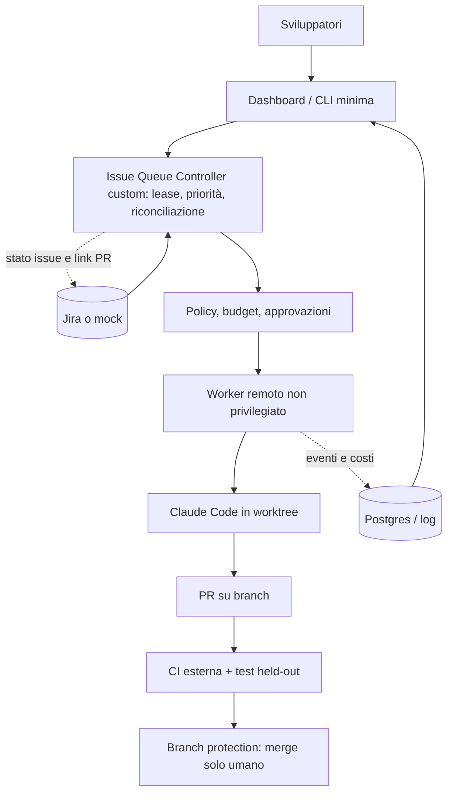

# Raccomandazione finale (provvisoria)

Data: 2026-10-20. **Stato: raccomandazione provvisoria basata su lettura di documentazione e sorgenti, più la prova locale di un controller di coda di riferimento. Nessun candidato è stato installato o eseguito, nessun test LIVE è stato fatto.** Per questo la confidenza è `bassa`, e l'ordine delle opzioni può cambiare dopo i test elencati al punto 10.

## 1. Executive summary

- Nessuno dei cinque candidati soddisfa da solo i requisiti MUST del documento. In particolare nessuno offre nativamente: coda Jira con lease (R01), piano con DAG e campi strutturati (R03), permessi di ruolo applicati dall'infrastruttura (R04.3), garanzia di PR senza merge automatico (R12.2) e verifica con CI esterna (R10.6).
- I default di sicurezza sono permissivi in tutti i candidati letti: `--dangerously-skip-permissions` e socket Docker (Warren), `dangerouslySkipPermissions=true` (Paperclip), `bypassPermissions` e merge diretto (Gas Town), `github_publish` con merge e un solo confine di fiducia (OpenClaw).
- Paperclip è il più completo su governance, budget, audit e multiutente (R09, R11). Warren ha il meccanismo di recovery e isolamento di run più chiaro (R08). Nessuno dei due copre Jira.
- La parte che manca a tutti, cioè coda con lease, idempotenza e riconciliazione, è piccola: il controller di riferimento è di 92 righe e 7 test passano. La versione di produzione costa di più (stima da 1.000 a 3.000 righe), ma è sotto il nostro controllo.
- **Indicazione provvisoria:** iniziare dallo stack minimale (Opzione A) e usare Warren come Execution Plane (Opzione B) solo se la baseline non regge i requisiti di run isolate e recovery. Rimandare Paperclip + Warren (Opzione C) finché collaborazione multiutente e budget centrali non diventano il collo di bottiglia.
- Questa indicazione segue anche la preferenza del documento (§13: validare prima Claude Code), ma **le capacità di Claude Code non sono state provate qui**.

## 2. Requisiti e priorità

Dettaglio in `docs/requirements/traceability.md` (53 requisiti). Per la PoC i `MUST` sono: coda Jira con lease, readiness e passaggio alla issue successiva (R01); piano con DAG (R03.1, R03.3); permessi di ruolo dell'infrastruttura (R04.3); scheduler deterministico, parallelismo sicuro, retry limitati (R05); budget con arresto reale (R06.3, R11.3); worker remoto con checkpoint (R08); handoff strutturato (R09.2); verification contract, review indipendente, blast radius, supervisor che ferma davvero, isolamento, CI esterna (R10); PR senza merge automatico (R12.2). Il documento non decide l'orchestratore e lascia aperte le scelte di §13.

## 3. Tabella comparativa

Vedi `reports/comparison.md` (copertura R01–R13, risultati S00–S10, gate bloccanti).

| | Paperclip | Paseo+Hub | OpenClaw | Warren | Gas Town | Baseline |
|---|---|---|---|---|---|---|
| Natura | control plane di «aziende di agenti» | daemon per agenti + dispatcher a eventi | assistente multicanale con Gateway | lifecycle manager di run isolate | orchestratore multi-agente a ruoli | Claude Code, un agente |
| Licenza | MIT | Apache-2.0 | MIT | MIT | MIT | — |
| Punto di forza | governance, budget, audit, multiutente | daemon, handoff, dispatch idempotente | canale umano, OpenTelemetry | recovery, salvage, cost cap | convoy, ruoli, gestione dei lavoratori | pochi componenti |
| Limite principale | nessun Jira, nessun gate CI, permessi agente ampi | niente sandbox, budget, DAG; Hub in sviluppo iniziale | confine di fiducia unico, merge in `github_publish` | socket Docker, nessun RBAC, nessun Jira nativo | merge diretto di default, nessun Jira, nessun budget | coda, multiutente, recovery centralizzato da dimostrare (§13) |
| Windows nativo | non verificato | non verificato | non verificato | `NOT_SUPPORTED` | CLI minimali; workflow completi su WSL/Docker | sì (Claude Code gira qui) |
| Provato qui | no | no | no | no | no | no |

## 4. Esperimenti, evidenze e limiti

- **Provato (`TESTED`, locale, MOCK, n=1):** fixture e harness (5 test visibili; held-out FAIL sul bug, PASS con il fix); controller di riferimento (7 test: issue bloccata e ambigua non scelte, nessun doppio claim, priorità, evento duplicato, riavvio con riconciliazione della lease, heartbeat).
- **Letto nei sorgenti (`CODE`):** socket Docker e `--dangerously-skip-permissions` in Warren, default `direct` del Refinery in Gas Town, default `true` in Paperclip, `merge` in `github_publish` di OpenClaw. Dettaglio in `reports/comparison.md`.
- **Non provato:** tutto il resto. S00–S10 sui candidati sono `BLOCKED`. Costi: nessuna spesa, token e costi `null`.
- **Limiti della ricerca:** `gh` non era autenticato (issue e metriche da pagine web, parziali); i checkout su Windows erano incompleti per Paseo e OpenClaw (file non materializzati), quindi parte delle affermazioni è `DOC` e non `CODE`; Warren e Gas Town: HEAD non coincide con un tag verificabile; le schede sono state redatte da agenti e verificate a campione da me su quattro affermazioni, non su tutte.

## 5. Proposta primaria, seconda scelta, opzione custom

| | Proposta | Perché | Trade-off |
|---|---|---|---|
| Primaria (provvisoria) | **A**: Claude Code remoto + Issue Queue Controller custom + CI e branch protection | meno componenti, controllo diretto su lease e policy, in linea con §13 | collaborazione multiutente e dashboard da costruire; capacità di Claude Code da dimostrare |
| Seconda scelta | **B**: Warren come Execution Plane + Control Plane custom minimo | recovery e run isolate già presenti | richiede Linux/WSL2, isolamento da irrobustire (socket Docker, `SYS_ADMIN`), progetto giovane |
| Differita | **C**: Paperclip + Warren | governance e multiutente già pronte | adapter Paperclip→Warren non verificato, due sistemi di stato, costo e rischio alti |

## 6. Architettura consigliata



Confini di fiducia: vedi `docs/security-threat-model.md`.

## 7. Componenti esistenti e da sviluppare

| Componente | Esistente | Da sviluppare | Sforzo | Rischio |
|---|---|---|---|---|
| Coding agent | Claude Code | configurazione di permessi e sandbox | basso | medio |
| Coda e lease | prova su mock (92 righe) | persistenza Postgres, webhook, Jira reale | medio | basso |
| Policy, budget, retry | — | applicati dal controller | medio | medio |
| Esecuzione isolata | Warren (opzione B) o container/VM | isolamento senza socket | medio-alto | alto |
| Review indipendente | — | secondo agente con specifica e diff | medio | medio |
| Knowledge (fase C) | Serena, `CLAUDE.md` | Context Pack, invalidazione | alto | medio |
| Dashboard | — | viste minime; Paperclip se serve la governance | medio-alto | medio |

## 8. Licenze, sicurezza, operatività, lock-in

Tutte licenze permissive (MIT o Apache-2.0), senza obblighi onerosi rilevati nella lettura. Rischi di sicurezza: sezione 4 di `reports/comparison.md` e threat model. Operatività: Warren e Gas Town richiedono Linux/WSL2; Hub dichiara possibile perdita di dati; Paperclip e OpenClaw sono molto attivi (rilasci frequenti, API instabili probabili, `UNVERIFIED`). Lock-in: basso con l'opzione A, medio con B (protocollo `warren-tracker/v1` sperimentale), alto con C.

## 9. Roadmap MVP incrementale

1. **Passo 0:** baseline LIVE con Claude Code su ISSUE-1 (n≥3) con sandbox e budget approvati: decide se un orchestratore serve.
2. **Fase A:** controller di coda con Jira sandbox, runner con timeout e retry, PR senza merge, CI esterna, test held-out.
3. **Fase B:** più worker in parallelo, collisioni, dashboard condivisa, handoff.
4. **Fase C:** Project Memory con Serena e file versionati, Context Pack, invalidazione.
5. **Fase D:** routing per task e benchmark dei modelli.
6. In parallelo, prototipo di Warren (smoke, kill del worker, S06) in una VM Linux dedicata, per confermare o scartare l'opzione B.

## 10. Decisioni aperte e test non eseguiti

Non eseguiti: S00–S10 sui cinque candidati; baseline LIVE; Jira sandbox; «lavora con il PC spento» (serve una VM remota); S07 con container.
Risorse necessarie: Docker Desktop attivo o una VM Linux; budget LLM massimo; un progetto Jira sandbox; autenticazione `gh` per le issue dei repository; eventuale autorizzazione al push.
Decisioni aperte: orchestratore, collocazione degli agenti, modelli, memoria (vedi `docs/decisions.md`).

## 11. Allegato — comandi per riprodurre e pulire

```bash
# Dalla radice della repository
(cd fixtures/seed-app && npm test)                              # 5 test visibili
node --test "fixtures/mock-integrations/*.test.mjs"             # 7 test del controller di riferimento
node scripts/evaluate.mjs fixtures/seed-app ISSUE-1 baseline S01 MOCK   # atteso: FAIL (bug presente)

# Pulizia: rimuove solo i risultati generati e i cloni di terze parti elencati
rm -f results/*.json
rm -rf "<scratchpad>/clones/{paperclip,paseo,paseo-hub-repo,openclaw,warren,gastown}"
```
